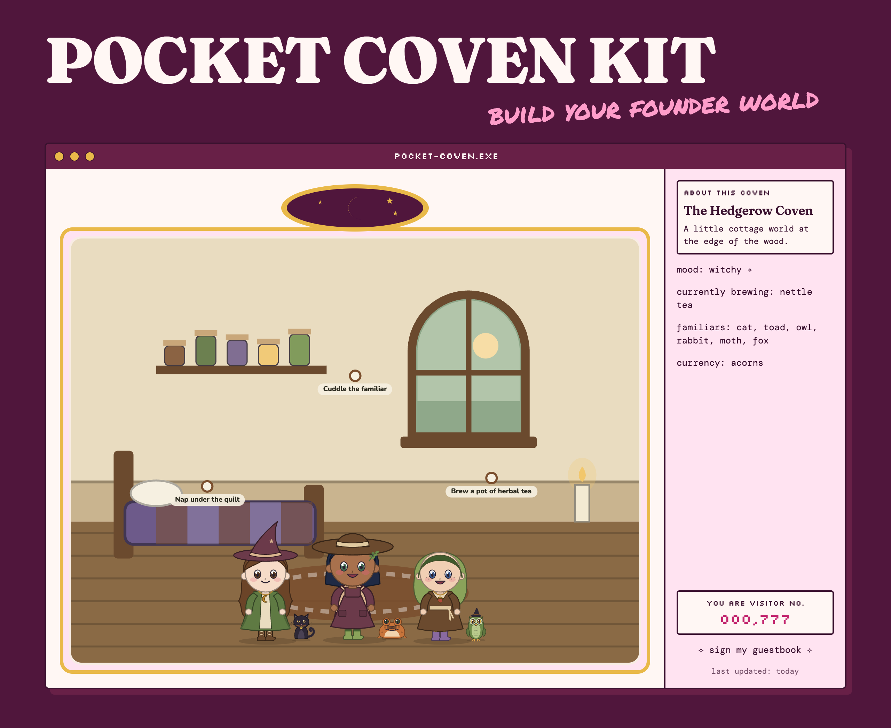
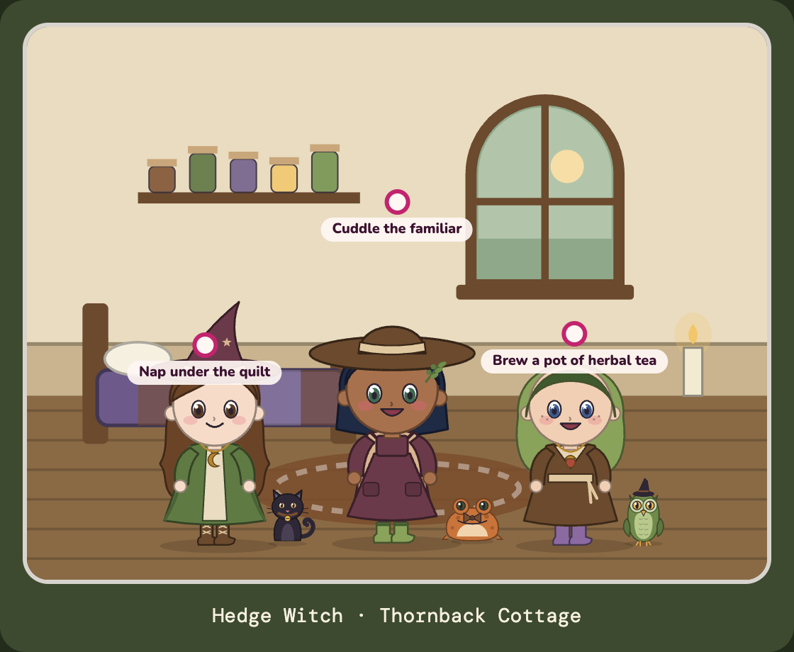
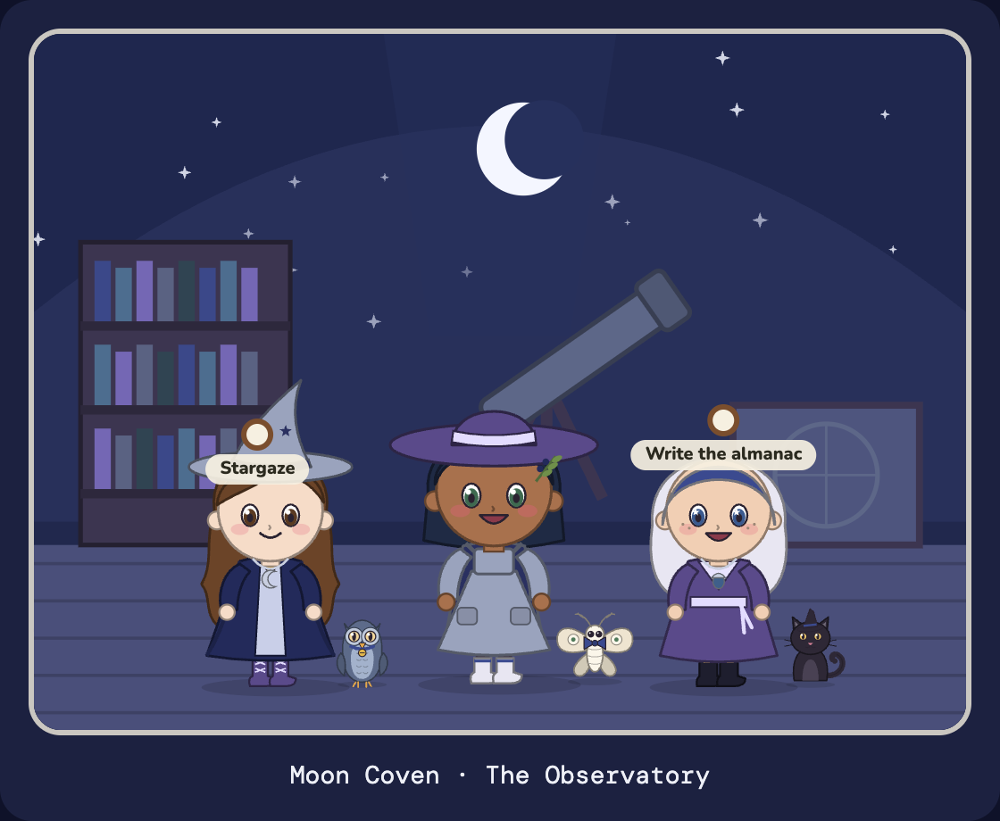
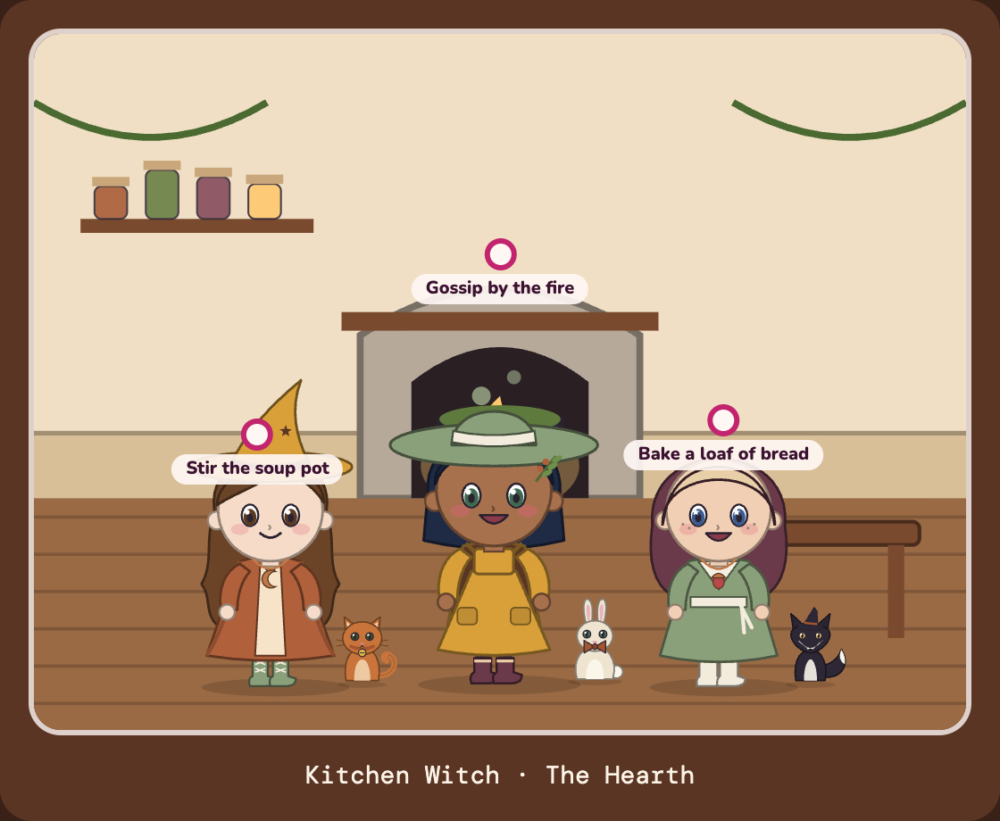
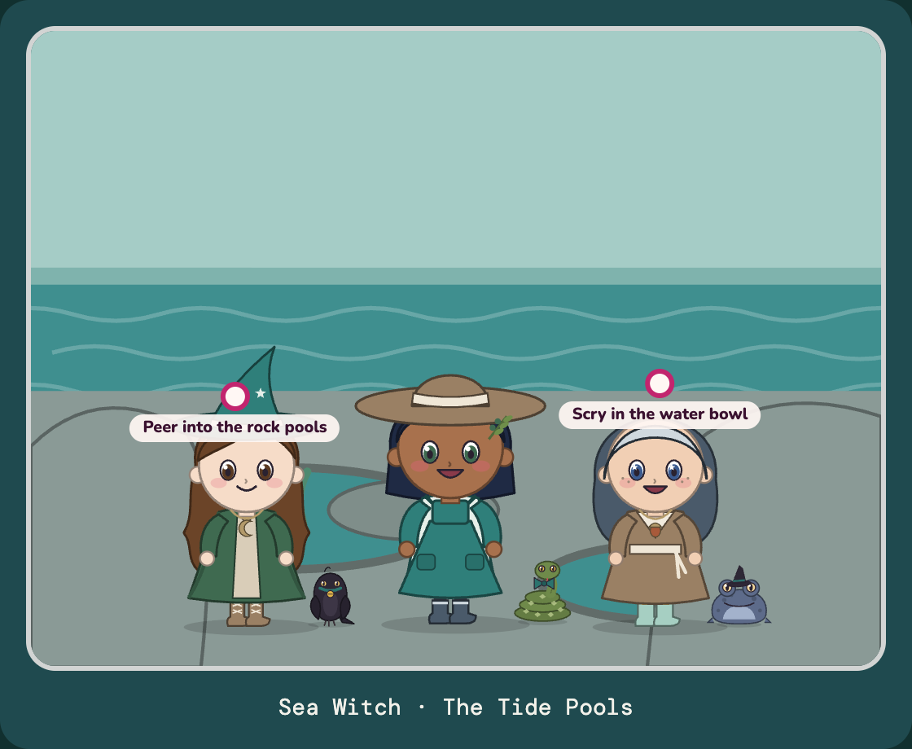
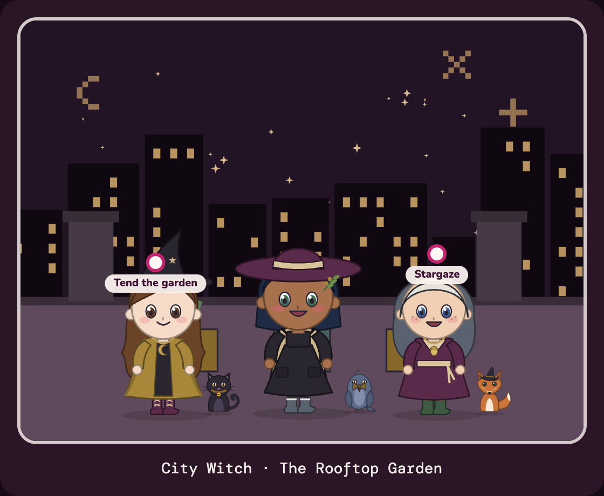
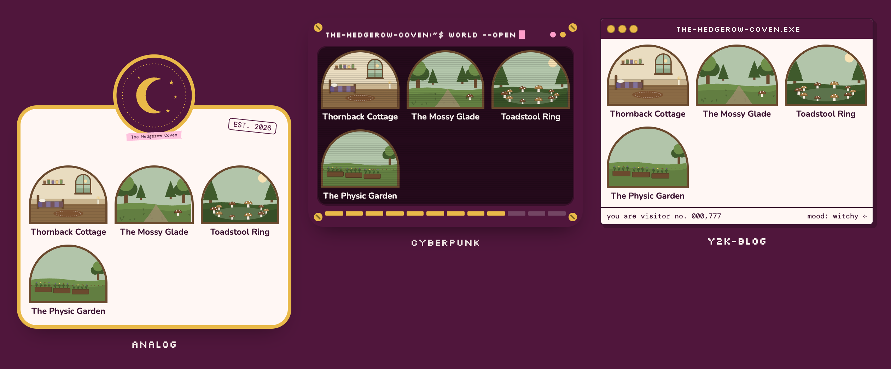

# Pocket Coven Kit

*Free tools from the Rocheverse.*



Build your own witchy pocket world.
Name your coven, theme your rooms, pick your familiars and outfits, invite your people.

It is a tiny multiplayer game for your community.
Everyone gets their own witch, with a familiar, a wardrobe and a room of her own.
She gets hungry, sleepy and bored if you leave her too long, and she cheers up when you come back.
Your people meet in the rooms you name, chat, send each other gifts, and gather for ceremonies under the real full moon.
It lives on your own accounts, with your own name on the door.

## A kit, not a clone

I built a pocket coven for my own people, and everyone asked for one.
So here is the kit.
It's a kit, not a clone of my coven.
Keep it witchy.
You choose the familiars and the outfits, you name the rooms and theme the spaces, you decide what your people call their money.
Your world, your witches, your rules.


## Start here

Five steps. The first four take about fifteen minutes and happen on your computer, with nothing online yet.
You need a Mac or Windows computer, [Claude Code](https://claude.com/claude-code), and two free helpers it uses: **Node** (the engine that runs the game on your computer, from [nodejs.org](https://nodejs.org), version 22 or newer) and **git** (it copies projects from GitHub; Macs ask to install it the first time you use it).

The **terminal** is the window where you type instructions to your computer.
On a Mac, press Command and Space together, type Terminal, and press Enter.
On Windows, open the Start menu and type Terminal.

 **Copy the kit onto your computer.** To **clone** is to copy a project from GitHub into a folder on your computer.
```sh
git clone https://github.com/RochaStone/pocket-coven-kit ~/.claude/skills/pocket-coven-kit
```
You will see "Cloning into" and then your prompt comes back. That means it worked.

 **Fetch the parts it needs.** This downloads the building blocks the game is made of. It takes a minute or two.
```sh
cd ~/.claude/skills/pocket-coven-kit && npm install
```
You will see "added" and a number of packages. A few yellow "warn" lines are normal.

 **Open Claude Code in that folder and ask for your coven.**
```sh
claude
```
Then type: `build my pocket coven`.
Claude asks you one question at a time: your coven's name, who it is for, which of the five worlds you like, what your people call their money, your rooms and what happens in each, which familiars to offer, and how many witches.
It writes your answers into one file, `coven.config.json`, and builds your world from it. You will see "Built" and your coven's name.

 **Look at your world.** This starts the game on your own computer.
```sh
npm run gallery
```
Open [localhost:3000/gallery](http://localhost:3000/gallery) in your browser. You will see your witches, every familiar, the wardrobe and all your rooms, painted in your colours. Press Control and C in the terminal to stop it.

 **Put it online on your own accounts.** When you are happy, tell Claude `let's put my coven online`. It walks you through making a free Supabase project and a free Vercel project, step by step, and sends your first invitation to you. The [Deploy](#deploy-on-your-own-accounts) section below has the same steps written out.

Want to play before you deploy? `npm run demo` starts a whole coven on your computer with three sample witches (it needs Docker Desktop, see [Play the demo](#play-the-demo)).


## Five worlds to start from

Each one comes with its own colours, six rooms with names, fourteen things to do, two ceremonies, its own flavour text, and its own money.
Pick one, then rename and rearrange everything.

| | |
|---|---|
|  **Hedge Witch.** A cottage at the edge of the wood. Moss greens, toadstools, acorns for money. |  **Moon Coven.** An observatory on a hill. Midnight blues and silver, moonstones for money. |
|  **Kitchen Witch.** A warm hearth, copper pans, herbs from the beams, and a scrapbook-blog look. Coppers for money. |  **Sea Witch.** Tide pools, driftwood and a singing cave. Teal water, grey stone, driftstones for money. |
|  **City Witch.** A rooftop above a sleeping city, seen through a plum screen with pixel sigils. Brass and lamplight, tokens for money. | |

## Three looks for the frame



The little case your world opens out of comes in three families: **analog** (paper you could hold), **cyberpunk** (the girly terminal) and **y2k-blog** (the 2003 blog page).
Set `"motif"` in `coven.config.json` to choose. The look changes shape, your colours stay yours.

## The guided setup

`SKILL.md` is the guide Claude follows. It asks one thing at a time, says back what it heard, and tells you what it is about to do before it does it.
Everything you choose lands in `coven.config.json`, which `WORLD.md` explains key by key.
After any change, this rebuilds your world and checks it:
```sh
npm run build:world
```
You will see "Built" with your rooms, witches and money. If something does not fit, it tells you which line and how to fix it, and writes nothing until it is right.

## Install

| Where you use it | Install it | Start it |
|---|---|---|
| Claude Code (recommended) | clone into `~/.claude/skills`, then `npm install` | say "build my pocket coven" |
| Claude Cowork | upload `pocket-coven-kit.zip` as a skill (Customize, then Skills, then Upload) | say "build my pocket coven" in a task |

**In Cowork,** Claude can run the whole interview, write your `coven.config.json` and show you your choices.
Building and putting the game online needs a terminal, so finish those steps in Claude Code on your desktop: copy the config file it made into the kit folder and run `npm run build:world`.

## Deploy on your own accounts

Your coven runs on two free accounts that belong to you.
**Supabase** keeps your coven's memory: the witches, their rooms, the chat, the logins.
**Vercel** puts the game on the web at an address you can share.
To **deploy** is to put the game online. Nothing here touches anyone else's account.

1. **Make a Supabase project** at [supabase.com](https://supabase.com) (New project, any name, save the database password somewhere safe).
2. **Connect the kit to it and build your coven's tables.** A **migration** is a set of instructions that builds the tables your game keeps its memory in. In the terminal, in the kit folder:
   ```sh
   npx supabase login
   npx supabase link --project-ref YOUR-PROJECT-REF
   npx supabase db push --include-seed
   npx supabase functions deploy claim-account
   ```
   Your project ref is the short code in your Supabase project's web address. You will see each migration listed and then "Finished".
3. **In Supabase, open Authentication, then URL Configuration.** Set Site URL to your Vercel address (step 5) and add `https://YOUR-ADDRESS/**` to Redirect URLs.
4. **Make a Vercel project** at [vercel.com](https://vercel.com): New Project, import your copy of the kit from GitHub.
5. **Add three environment variables in Vercel** (Settings, then Environment Variables). An **environment variable** is a setting kept outside the code, like an address or a key. Copy the first two from Supabase (Project Settings, then API):
   - `NEXT_PUBLIC_SUPABASE_URL`: your project URL
   - `NEXT_PUBLIC_SUPABASE_ANON_KEY`: the anon or publishable key (safe in the browser)
   - `NEXT_PUBLIC_SITE_URL`: your Vercel address

   Then press Deploy. When it finishes, Vercel shows your new address.
6. **Send yourself the first invitation.** Copy `.env.example` to `.env.local`, fill in the same three values plus `SUPABASE_SERVICE_ROLE_KEY` (the secret key: it stays on your computer, never in Vercel), then:
   ```sh
   node --env-file=.env.local scripts/create-invite.mjs
   ```
   You will see a link. Open it, make your login, and you are the owner witch. Every other invite comes from the **Owner** tab inside the game.

Changed your rooms later? Run `npm run build:world`, then `npx supabase db push --include-seed` again. Your witches keep everything they own.

## Play the demo

`npm run demo` builds the Hedge Witch demo world, starts a Supabase on your own computer, and lets in three sample witches: Bramble (you, the owner), Fern and Sorrel. Fern and Sorrel are already chatting.
It needs **Docker Desktop** (a free app that runs Supabase's parts on your computer) installed and open.
When it finishes it prints a login. Run `npm run dev` and open [localhost:3000](http://localhost:3000).

## What's inside

- **The game.** Needs that fall over time and never to zero, seven moods, cooldowns, a ledger for your money, a seven-slot wardrobe, a room to decorate on a grid, live presence, chat with stickers, gifts, a daily oracle card, weekly coven goals, ceremonies that need two witches or more, full and new moon ceremonies on the real moon, family logins for a grown-up and a young witch, and an Owner screen for invites, moderation and settings.
- **The world builder.** `coven.config.json` plus a theme preset becomes the game's whole catalogue and its database seed. 18 room backdrops, 40 activities to choose from, 16 oracle cards.
- **The art.** Original drawings made in code: a witch builder (eight hairstyles, skin, eyes, freckles, moods, every wardrobe piece), a familiar builder (cat, owl, moth, fox, toad, raven, snake, rabbit, in six colours with a bell, a bow or a tiny hat), 30 or more wearables per world, furniture, treasures and treats.
- **Safety.** Every action is checked on the server. Players can read only what their coven may see and can never write a row directly. Invite links are single-use and stored only as a scrambled fingerprint.
- **Tests.** The world builder, every preset, the config checks, pronoun-neutral flavour text, a scan that nothing from my own coven leaks in, and 45 database tests of the game engine. `tests/TESTING.md` has the details.

## If it goes wrong (everyone's first time) 

- **"command not found: npm" or "node".** Node is not installed yet. Install the LTS version from [nodejs.org](https://nodejs.org), close the terminal, open a new one, and try again.
- **`npm run build:world` lists problems.** Nothing is broken. It is telling you which line of `coven.config.json` to change, in plain words. Ask Claude "fix my coven config" and it will.
- **The game says the database is not connected yet.** It cannot find your Supabase settings. Locally, check `.env.local` has the three `NEXT_PUBLIC_` lines filled in. On Vercel, check the three environment variables, then redeploy.

## Make it yours

The game's colours come from your theme preset and anything you set under `"palette"` in `coven.config.json`.
`style.json` is the one style file shared by every Rocha Coded tool. In this kit it colours the compact's case, rim and lining and this README's images: copy `style.example.json` to `style.json` and fill in your own.
Two examples ship: `examples/style.rocha-coded.json` (mine) and `style.example.json` (blank). `STYLE.md` explains every key.

## Where it came from

This kit was built from my own pocket coven game.
My witches, rooms, art and words stayed home.
The engine is shared under the MIT licence, so it is yours to change.

[Sign my guestbook](https://github.com/RochaStone/pocket-coven-kit/issues)

## Made by Rocha

Rocha \
Brand Alchemist & AI Architect \
Author of *Brand Alchemy in the Thriving Era* \
Creator of [Conscious Founder Operating System](https://founders.thrivingera.com) \
Founder, [Thriving Era Studio](https://thrivingera.com)

I help female founders build their founder world, and I build what they need next. \
Start with the audit: [thrivingera.com/audit](https://thrivingera.com/audit). \
Or book an exploratory call: [calendly.com/rochelle-thrivingera/exploratory-call](https://calendly.com/rochelle-thrivingera/exploratory-call). It is where we decide if we work together.

[Instagram @rocheverse](https://instagram.com/rocheverse) · [Substack](https://rochastone.substack.com) · [LinkedIn](https://www.linkedin.com/in/rochellelivingstonecosmic) · [More free tools](https://thrivingera.com/free) · [All tools on GitHub](https://github.com/RochaStone)
